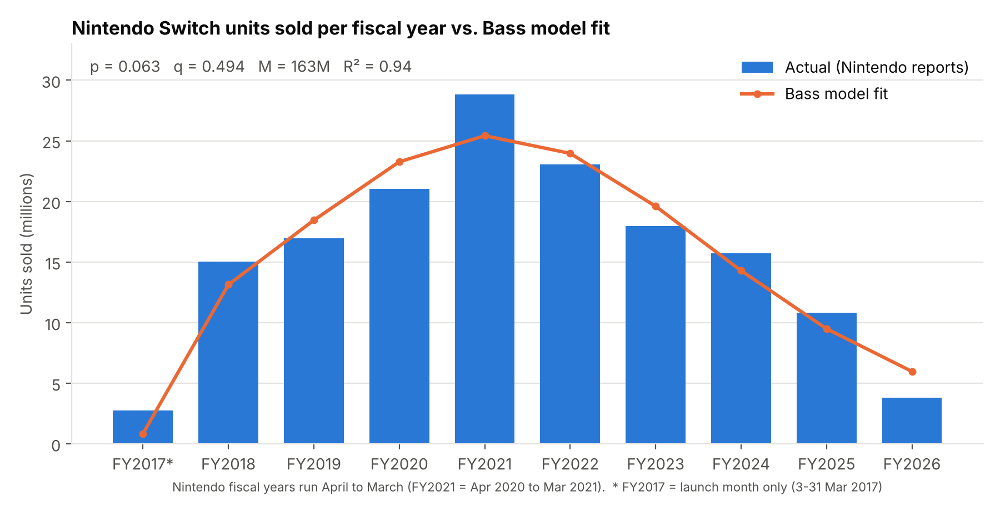
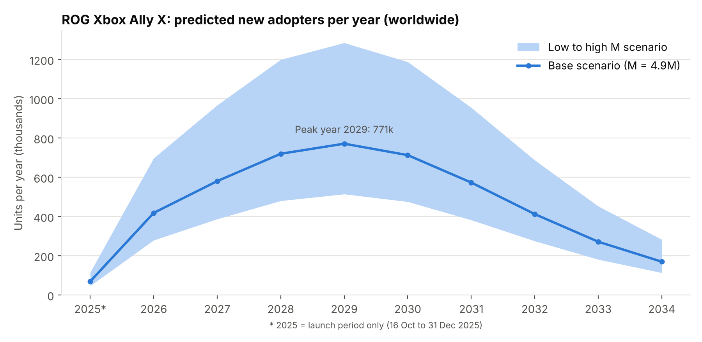
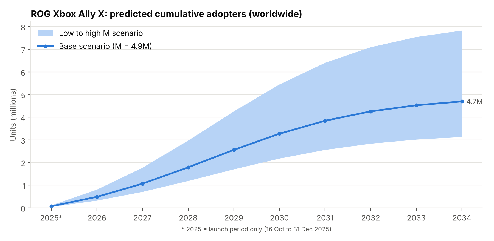

# 1. The innovation: ROG Xbox Ally X

**Chosen product:** ROG Xbox Ally X, a handheld gaming PC made by ASUS together with Microsoft, listed in TIME's Best Inventions of 2025 (Entertainment and Gaming).
Link: <https://time.com/collections/best-inventions-2025/7318306/xbox-rog-ally-x/>

TIME describes it as a handheld that plays games from a player's Xbox and PC libraries and runs Windows 11, so it can also run PC games from other stores [1]. Key facts:

- **Launch:** 16 October 2025, in 38 countries at once [2].
- **Price:** \$999.99 for the Ally X (a cheaper ROG Xbox Ally costs \$599.99) [2].
- **Early demand:** in November 2025 ASUS said demand for the Ally X had exceeded its expectations and that the high-end model was in short supply [3].

# 2. The look-alike innovation: Nintendo Switch (2017)

The closest past innovation with reliable sales data is the **Nintendo Switch**, launched worldwide on 3 March 2017 at \$299.99 [10].

**Why they are similar.** Both are handheld game consoles: a screen with built-in controls that lets people play full-size games anywhere, not only in front of a TV or a desk (the Switch can also be docked to a TV; the Ally X is a full Windows 11 PC [1]). Both pack console-quality games into a battery-powered device running on a low-power chip designed for portable use. And the Switch turned high-quality portable gaming into a mass-market product: Nintendo has sold 155.92 million units [9]. Omdia says that the "Switch's unique selling point of high-quality gaming on the go has now been commoditized", and that the Switch 2 upgrade cycle gives rival vendors a chance to draw Switch owners toward their own handhelds [11]. That is the space the Ally X is competing for.

**Key differences, and why not the Steam Deck.** The Ally X costs about three times the Switch's launch price and has no exclusive games, while the Switch has Nintendo's own games, so the Ally X's market will be much smaller. This is handled through the market potential *M* (Section 6), while *p* and *q* are taken from the Switch. The product closest to the Ally X is Valve's Steam Deck (2022), but Valve does not publish regular sales figures (it has only said it sold "several million"), so its yearly numbers are analyst estimates [12]. The first ROG Ally (2023) has the same problem: ASUS gives revenue for the Ally line, not units [3]. The Switch has ten fiscal years of unit sales reported by Nintendo, which is what fitting the Bass model needs.

# 3. Historical data

**Source:** Nintendo's official financial results, which report Switch hardware units sold every fiscal year (April to March) [4]–[9]. The same series is also on Statista [14].

File: `data/nintendo_switch_hardware_units.csv`. **All 10 values are reported by Nintendo**; none are estimated. They add up to 155.93 million, matching Nintendo's life-to-date total of 155.92 million at 31 March 2026 [9] (the 0.01 difference is rounding).

| Fiscal year | Period | Units sold (million) | Bass fit (million) |
|:---|:---|---:|---:|
| FY2017\* | Mar 2017 – Mar 2017 | 2.74 | 0.83 |
| FY2018 | Apr 2017 – Mar 2018 | 15.05 | 13.13 |
| FY2019 | Apr 2018 – Mar 2019 | 16.95 | 18.45 |
| FY2020 | Apr 2019 – Mar 2020 | 21.03 | 23.27 |
| FY2021 | Apr 2020 – Mar 2021 | 28.83 | 25.42 |
| FY2022 | Apr 2021 – Mar 2022 | 23.06 | 23.96 |
| FY2023 | Apr 2022 – Mar 2023 | 17.97 | 19.60 |
| FY2024 | Apr 2023 – Mar 2024 | 15.70 | 14.28 |
| FY2025 | Apr 2024 – Mar 2025 | 10.80 | 9.49 |
| FY2026 | Apr 2025 – Mar 2026 | 3.80 | 5.97 |

\* FY2017 covers only the launch month (3–31 March 2017). In the model each period keeps its real length, so this short first period is handled correctly rather than treated as a full year (Section 4 shows why this matters).

# 4. Estimating the Bass parameters

The Bass model [15] splits adopters into innovators (driven by *p*, the coefficient of innovation) and imitators (driven by *q*, the coefficient of imitation). The share of the market that has adopted by time *t* (years since launch) is

$$F(t) = \frac{1 - e^{-(p+q)t}}{1 + \frac{q}{p}e^{-(p+q)t}}, \qquad n(t_1, t_2) = M\,[F(t_2) - F(t_1)]$$

where $n(t_1, t_2)$ is the number of adopters between times $t_1$ and $t_2$, and *M* is the market potential.

**Method.** I estimated *p*, *q* and *M* with **nonlinear least squares** [16] on the 10 fiscal-year values (`fit_lookalike.py`).

| Parameter | Estimate | Standard error | 95% confidence interval |
|:---|---:|---:|---:|
| *p* (innovation) | **0.0633** | 0.0084 | 0.0434 to 0.0832 |
| *q* (imitation) | **0.494** | 0.058 | 0.356 to 0.631 |
| *M* (million units) | **163.1** | 8.7 | 142.6 to 183.6 |

R² = 0.94 on 10 observations. The *p* and *q* estimates are strongly negatively correlated (−0.79): a fit with a higher *p* needs a lower *q*. This matters for the uncertainty analysis in Section 5.

**What the numbers say.**

- **Both innovation and imitation mattered.** The Switch's *p* = 0.063 is about twice the average of 0.03 in the Sultan, Farley & Lehmann meta-analysis [17], which reflects a very strong launch (2.74 million units in its first four weeks). Its *q* = 0.49 is above their average of 0.38, showing strong word of mouth.
- **The model peak matches reality.** The model's adoption rate peaks in **November 2020** (*t\** = ln(*q*/*p*)/(*p*+*q*) = 3.69 years after launch). Actual sales peaked in FY2021 (April 2020 – March 2021).
- **Total sales match.** The model gives 154.4 million units sold by March 2026, versus 155.93 million actual.
- **Where the fit misses:** the launch month is under-predicted (0.83 vs 2.74 million), FY2021, the first year of the COVID-19 pandemic, is above the curve, and FY2026 is below it, the year the Nintendo Switch 2 went on sale (19.86 million Switch 2 units sold that year [9]).

**Robustness.** I refit the model in three other ways (`data/robustness_fits.csv`):

| Version of the fit | *p* | *q* | *M* (million) |
|:--------------------------------------------------|-------:|-------:|----------:|
| Main: each period keeps its real length | 0.063 | 0.494 | 163.1 |
| Launch month treated as a full year (t = 1, 2, ..., 10) | 0.032 | 0.575 | 163.6 |
| Launch month merged into FY2018 | 0.068 | 0.466 | 166.2 |
| Without FY2026 (the year Switch 2 launched) | 0.065 | 0.464 | 167.3 |

Treating the 4-week launch month as a full year halves *p*, because the model then reads 2.74 million units as a whole year of sales instead of four weeks. Keeping the real period lengths avoids this, and the other two checks move *p* and *q* only a little.

# 5. Predicting the diffusion of the ROG Xbox Ally X

I keep the Switch's **p = 0.0633** and **q = 0.494** and combine them with a market potential *M* built for the Ally X (Section 6). Time starts at the launch on 16 October 2025, and results are reported by calendar year. 2025 covers only the launch period (16 October – 31 December).

The forecast (base case, rounded to the nearest thousand):

- About **69,000 units** in the 2025 launch period and **418,000** in 2026.
- Sales **peak in 2029** at about **771,000 units** (the model's peak moment is June 2029, 3.69 years after launch).
- By 2034, about **4.7 million** Ally X units in total (95% of the base market potential).

**Uncertainty in *p* and *q*.** Because *p* and *q* move in opposite directions (Section 4), setting both to the low ends (or both to the high ends) of their own 95% intervals at once would overstate the uncertainty. Instead, I drew 10,000 (*p*, *q*) pairs from their estimated joint distribution and recomputed the forecast with the base *M* (`data/sensitivity_pq.csv`):

| Result (base *M*) | Main estimate | 95% range |
|:---|:---|:---|
| Peak of the adoption rate | June 2029 | February – November 2029 |
| Cumulative units by end of 2027 | 1.07 million | 0.89 – 1.21 million |
| Cumulative units by end of 2030 | 3.27 million | 2.97 – 3.55 million |

This range is narrow next to the low–high range for *M* (Section 6), so *M* is the main source of uncertainty.

**How to read the later years.** PC handhelds are replaced quickly: ASUS launched the ROG Ally in June 2023 [19], the ROG Ally X in July 2024 [20] and the ROG Xbox Ally X in October 2025 [2]. The Switch's *p* and *q* come from a console that has now been on sale for nine years, so the curve's timing (peak in 2029) probably runs long for a single model. Sales after about 2027 are best read as the Ally X together with its direct successors.

# 6. Scope: worldwide

I analyze the **whole world** rather than one country because:

1. **It launched globally on one day:** 16 October 2025 in 38 countries [2].
2. **Its platforms are global.** It plays games from Xbox Game Pass and PC stores, which are sold worldwide, and the Switch data used for *p* and *q* is also worldwide.
3. **The best market data is global.** The public figures from Omdia and IDC on handheld gaming PCs are worldwide totals [11][12]; I found no reliable country-level data.

**Fermi estimate of M (market potential).** *M* = worldwide PC-handheld sales during the Ally X's selling life × the share of those sales the Ally X wins.

| Input | Value | Source |
|:------------------------|:------------------------------|:----------------------------------|
| PC gaming handhelds sold in 2025 | 2.3 million | Omdia [11] |
| PC gaming handhelds sold per year by 2029 | 4.7 million | Omdia [11] |
| Years 2026–2028 | growing 19.6% per year | Assumption: steady growth between Omdia's two points |
| Years 2030–2033 | 4.7 million per year | Assumption: flat after Omdia's forecast ends |
| Selling life | 8 years from launch (16 Oct 2025 – 15 Oct 2033) | The Switch sold 97.6% of its units to date in its first 8 years [8][9] |
| First and last year | counted by days (77 days of 2025, 288 days of 2033) | Only the part of each year inside the selling life |
| **PC-handheld sales during the selling life** | **33.0 million** | Sum of the path below |
| Ally X share of PC-handheld sales | 10% / 15% / 25% | Assumption, explained below |

Market path used (`data/pc_handheld_market_path.csv`): 2025 (from 16 Oct): 0.49M · 2026: 2.75M · 2027: 3.29M · 2028: 3.93M · 2029–2032: 4.70M per year · 2033 (to 15 Oct): 3.71M.

**Why 15% for the base share.** In November 2025, ASUS guided that its Ally line would bring in about NT\$4–5 billion (\$130–160 million) per quarter [3]. If every unit were the \$999.99 Ally X, that is roughly 130,000–160,000 units per quarter, or about 0.52–0.64 million per year: roughly 23–28% of the 2.3 million PC handhelds sold in 2025. This is only a rough ceiling. ASUS's revenue per unit is its wholesale price, a little below the shop price, which would mean slightly more units; but part of the revenue comes from the cheaper \$599.99 Ally, so the Ally X's own share must be lower. I use 15% as the base, 10% as low and 25% as high. The market is also competitive: IDC estimates that Valve's Steam Deck took more than half of all handheld PC shipments in 2022–2024 (over 3.7 million of about 6 million) [12].

| Scenario | Calculation | *M* |
|:---|:---|---:|
| Low | 32.96M × 0.10 | **3.3 million units** |
| Base | 32.96M × 0.15 | **4.9 million units** |
| High | 32.96M × 0.25 | **8.2 million units** |

*M* is the Ally X's lifetime total; the Bass curve decides when those sales happen. By the end of the selling life (October 2033) the model has reached 91% of *M*, and the rest comes later, just as the Switch still sold 3.8 million units in its ninth year on sale [9].

**Cross-checks against outside data** (`data/cross_checks.csv`):

- **Launch quarter.** For Q4 2025, ASUS expected NT\$3–5 billion (\$96–160 million) of Ally-line sales [3]. Even if every unit were a \$999.99 Ally X, that is roughly 96,000–160,000 units. The base forecast for the launch period (about 69,000) is below this, which leaves room for sales of the cheaper Ally. The model may still be on the low side: it also under-predicted the Switch's launch month (0.83 vs 2.74 million).
- **2026.** The same guidance gives roughly 0.52–0.64 million units a year if all were Ally X. The base forecast for 2026 (about 418,000) fits under it.
- **Steam Deck.** IDC estimates that the Steam Deck, the market leader, shipped over 3.7 million units in 2022–2024, roughly its first three years [12]. The base forecast gives the Ally X about 1.79 million units by the end of 2028, its own first three years: under half the Steam Deck's volume, for a device that costs about 2.5 times the Steam Deck's \$399 starting price [2][13]. In a market that Omdia expects to double by 2029 [11], that looks reasonable.

# 7. Estimated adopters by year

Full results (exact model output): `data/allyx_forecast.csv`. The table below is rounded to the nearest thousand.

| Year | New (low) | New (base) | New (high) | Cumulative (base) |
|---:|---:|---:|---:|---:|
| 2025\* | 46,000 | 69,000 | 115,000 | 69,000 |
| 2026 | 279,000 | 418,000 | 697,000 | 487,000 |
| 2027 | 387,000 | 580,000 | 967,000 | 1,068,000 |
| 2028 | 480,000 | 720,000 | 1,200,000 | 1,788,000 |
| 2029 | 514,000 | 771,000 | 1,285,000 | 2,559,000 |
| 2030 | 475,000 | 713,000 | 1,188,000 | 3,272,000 |
| 2031 | 382,000 | 573,000 | 955,000 | 3,845,000 |
| 2032 | 275,000 | 412,000 | 687,000 | 4,257,000 |
| 2033 | 181,000 | 271,000 | 452,000 | 4,529,000 |
| 2034 | 113,000 | 170,000 | 283,000 | 4,698,000 |

\* 2025 = launch period only (16 October – 31 December 2025).

# 8. Limitations

- **Units sold, not people.** Nintendo reports units shipped to stores (sell-in), counts all Switch models together, and some households own more than one console.
- **The Switch's late decline is partly the Switch 2.** The new console took over in FY2026, and the model reads this as the market filling up.
- **Different product.** The Ally X costs about three times more and has no exclusive games. Taking *p* and *q* from the Switch assumes word of mouth spreads in a similar way among gamers.
- **Short product cycles.** A new Ally model has come out every year since 2023 [2][19][20], so the later years of the forecast describe the Ally X together with its successors (Section 5).
- **M depends on a forecast and an assumption.** The PC-handheld market path comes from Omdia's forecast, and the Ally X share is my assumption; the low and high scenarios show how much this matters.
- **No public Ally X unit sales yet.** ASUS reports revenue, not units, so the forecast can only be checked against ASUS's revenue guidance (Section 6), not against real unit sales.
- **Constant M.** The standard Bass model ignores price cuts and promotions; the Generalized Bass Model [18] could add them once data exists.

# References

[1] TIME (2025). *ROG Xbox Ally X: The Best Inventions of 2025.* <https://time.com/collections/best-inventions-2025/7318306/xbox-rog-ally-x/>

[2] Generación Xbox (26 September 2025). *ROG Xbox Ally X can now be reserved in over 30 countries: complete list and prices.* <https://en.generacionxbox.com/rog-xbox-ally-x-can-now-be-reserved-in-over-30-countries-complete-list-and-prices/>

[3] Pure Xbox (14 November 2025). *ROG Xbox Ally X demand has "exceeded expectations" and ASUS is ramping up production* (citing ASUS's Q3 2025 investor call). <https://www.purexbox.com/news/2025/11/rog-xbox-ally-x-demand-has-exceeded-expectations-and-asus-is-ramping-up-production>

[4] Nintendo Co., Ltd. (27 April 2017). *Consolidated Financial Statements, fiscal year ended March 2017.* <https://www.nintendo.co.jp/ir/pdf/2017/170427e.pdf>

[5] Nintendo Co., Ltd. (25 April 2019). *Consolidated Financial Statements, fiscal year ended March 2019.* <https://www.nintendo.co.jp/ir/pdf/2019/190425e.pdf>

[6] Nintendo Co., Ltd. (6 May 2021). *Financial Results Explanatory Material, fiscal year ended March 2021.* <https://www.nintendo.co.jp/ir/pdf/2021/210506_4e.pdf>

[7] Nintendo Co., Ltd. (9 May 2023). *Financial Results Explanatory Material, fiscal year ended March 2023.* <https://www.nintendo.co.jp/ir/pdf/2023/230509_4e.pdf>

[8] Nintendo Co., Ltd. (8 May 2025). *Financial Results Explanatory Material, fiscal year ended March 2025.* <https://www.nintendo.co.jp/ir/pdf/2025/250508_4e.pdf>

[9] Nintendo Co., Ltd. (8 May 2026). *Financial Results Explanatory Material, fiscal year ended March 2026.* <https://www.nintendo.co.jp/ir/pdf/2026/260508_4e.pdf>

[10] TweakTown (13 January 2017). *Nintendo Switch launches March 3 for \$299.99* (Nintendo press release). <https://www.tweaktown.com/pressrelease/10985/nintendo-switch-launches-march-299-99/index.html>

[11] Omdia (18 August 2025). *2.3 Million PC Gaming Handhelds Will Be Sold in 2025, According to Omdia.* Business Wire. <https://www.businesswire.com/news/home/20250818591008/en/2.3-Million-PC-Gaming-Handhelds-Will-Be-Sold-in-2025-According-to-Omdia>

[12] GIGAZINE (26 February 2025). *Steam Deck has sold about 4 million units in the three years since its release, dominating 50% of the handheld gaming PC market* (citing IDC estimates). <https://gigazine.net/gsc_news/en/20250226-handheld-gaming-shipments>

[13] Pocket Gamer.biz (July 2021). *Valve reveals Steam Deck handheld, launching from \$399 this year.* <https://www.pocketgamer.biz/news/76899/valve-reveals-steam-deck-handheld-launching-from-399-this-year/>

[14] Statista. *Nintendo Switch hardware sales worldwide FY 2017–FY 2026* (source: Nintendo). <https://www.statista.com/statistics/1117725/nintendo-switch-hardware-sales/>

[15] Bass, F. M. (1969). A new product growth for model consumer durables. *Management Science*, 15(5), 215–227.

[16] Srinivasan, V., & Mason, C. H. (1986). Nonlinear least squares estimation of new product diffusion models. *Marketing Science*, 5(2), 169–178.

[17] Sultan, F., Farley, J. U., & Lehmann, D. R. (1990). A meta-analysis of applications of diffusion models. *Journal of Marketing Research*, 27(1), 70–77.

[18] Bass, F. M., Krishnan, T. V., & Jain, D. C. (1994). Why the Bass model fits without decision variables. *Marketing Science*, 13(3), 203–223.

[19] Notebookcheck (12 May 2023). *ASUS ROG Ally: Pre-orders open with cheaper AMD Ryzen Z1 model to follow* (ROG Ally ships from 13 June 2023 at \$699.99). <https://www.notebookcheck.net/ASUS-ROG-Ally-Pre-orders-open-with-cheaper-AMD-Ryzen-Z1-model-to-follow.717043.0.html>

[20] TechRadar (2 June 2024). *Asus ROG Ally X is finally coming with improved specs and hardware – a PC gamer's dream* (launch on 22 July 2024 at \$799.99). <https://www.techradar.com/gaming/consoles-pc/asus-rog-ally-x-is-finally-coming-with-improved-specs-and-hardware-a-pc-gamers-dream>
